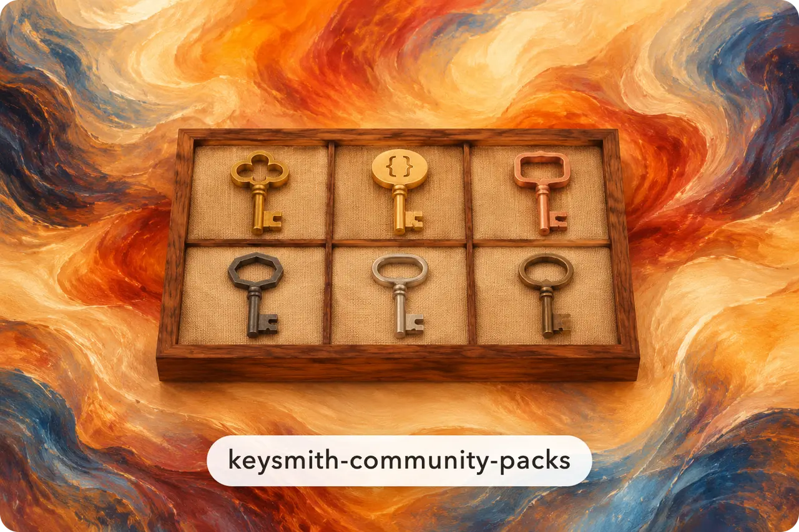
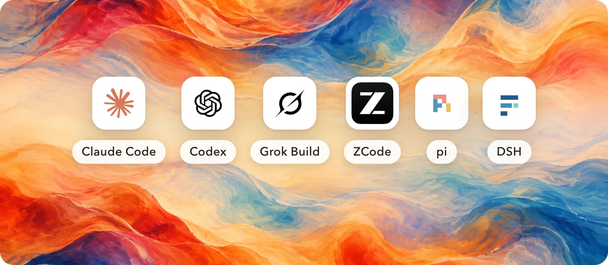
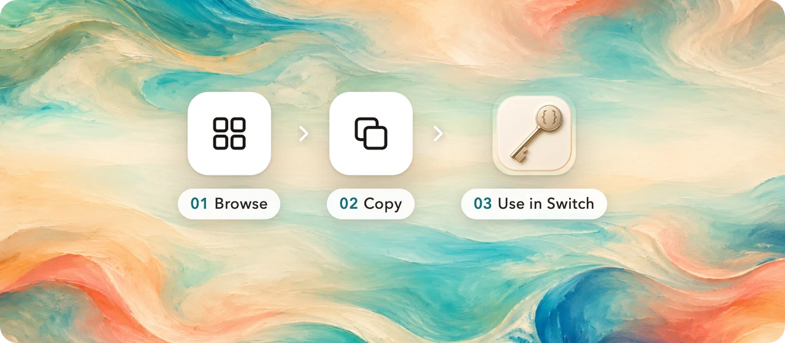
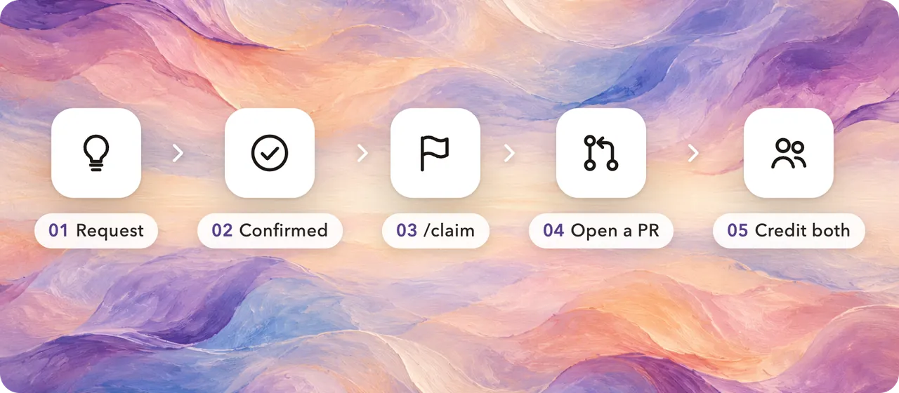
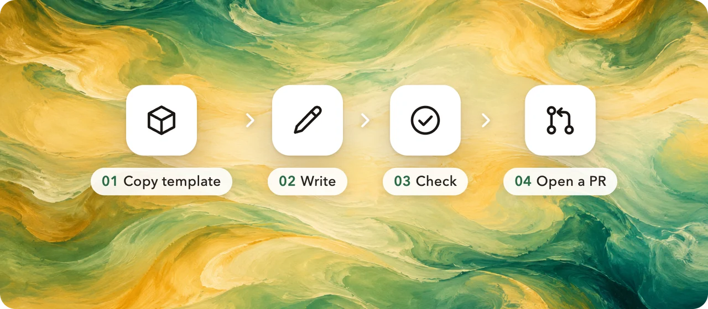
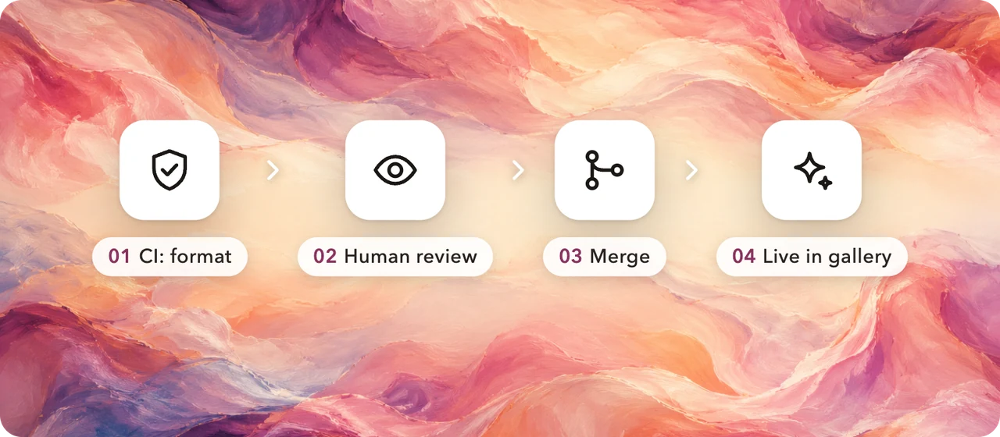

<!-- markdownlint-disable MD013 MD033 MD041 -->

<div align="center">



<h1>Keysmith Community Packs</h1>

<p><b>Prompt packs made by the community, all in one place. Pick one and use it, or add your own.</b></p>

<p>
  <a href="https://keysmithswitch.com/en/packs/"></a>
  <a href="https://github.com/Jia-Ethan/keysmith-community-packs/actions/workflows/ci.yml"></a>
  <a href="https://github.com/Jia-Ethan/keysmith-community-packs/stargazers"></a>
  
  <a href="https://t.me/+xBqLYA65JPU1NjFk"></a>
</p>

<p>
  <a href="https://keysmithswitch.com/en/packs/"><b>Browse the gallery</b></a> ·
  <a href="https://github.com/Jia-Ethan/keysmith-community-packs/issues?q=is%3Aissue+is%3Aopen+label%3Aready"><b>Claim a request</b></a> ·
  <a href="CONTRIBUTING.en.md"><b>Contribute</b></a> ·
  <a href="docs/SPEC-community.md">Format</a> ·
  <a href="README.md">简体中文</a>
</p>

</div>

## Works with six agents



Community packs use **the same format** as the official [Keysmith Switch](https://github.com/Jia-Ethan/keysmith-switch) extension packs. A pack holds prompts and rules only, **never executable code**.

## Use a pack



Pick a pack in the **[gallery](https://keysmithswitch.com/en/packs/)**, copy its prompt, and paste it into "My prompts" in Keysmith Switch. One-click install inside the app is planned.

## Don't code? File a request



**[File a request](https://github.com/Jia-Ethan/keysmith-community-packs/issues/new?template=request.yml)**: say what you want an agent to do and how we'll know it works. Builders pick it from the **[request pool](https://github.com/Jia-Ethan/keysmith-community-packs/issues?q=is%3Aissue+is%3Aopen+label%3Aready)** with `/claim`, open a PR, and the gallery credits both the idea and the build. Not just prompts: ideas that reshape the agent itself (commands, hooks, MCP…) are welcome too. [How it works](docs/requests.en.md)

## Contribute a pack



```bash
# 01 copy the example pack (pack folder + sidecar)
cp -r packs/example.hello           packs/<handle>.<slug>
cp    packs/example.hello.meta.json packs/<handle>.<slug>.meta.json
# 02 write prompts/*.md, edit pack.json and the sidecar
python3 scripts/check.py           # 03 everything must say ok
# 04 open a PR
```

Full steps in **[CONTRIBUTING.en.md](CONTRIBUTING.en.md)**. Pack ids look like `<handle>.<slug>`; ids starting with `keysmith.` are reserved for official packs.

## Every pack is reviewed by a person



CI checks the format only. A maintainer reads every pack before merging ([review checklist](docs/review-checklist.md)). Once merged, the pack shows up in the website gallery on its next automatic rebuild.

<details>
<summary><b>What's in this repo</b></summary>

```
packs/<id>/            a community pack (schema 1, content only)
packs/<id>.meta.json   its sidecar: author, gallery copy, category
scripts/check.py       validation, local and in CI
scripts/build_index.py builds community-index.json for the gallery
scripts/packlib.py     the official validator (vendored as is, do not edit)
docs/                  format spec, review checklist
```

</details>

## The Keysmith family

- [**Keysmith Switch**](https://github.com/Jia-Ethan/keysmith-switch): a desktop app that manages the prompts of all your agents in one place
- Instruction packs per agent: [codex-keysmith](https://github.com/Jia-Ethan/codex-keysmith) · [claude-keysmith](https://github.com/Jia-Ethan/claude-keysmith) · [grok-keysmith](https://github.com/Jia-Ethan/grok-keysmith) · [zcode-keysmith](https://github.com/Jia-Ethan/zcode-keysmith) · [pi-keysmith](https://github.com/Jia-Ethan/pi-keysmith) · [dsh-keysmith](https://github.com/Jia-Ethan/dsh-keysmith)

<div align="center">
<br />

**Find it useful? Give it a ⭐ star. Have a prompt that works well? Share it as a pack.**

</div>
