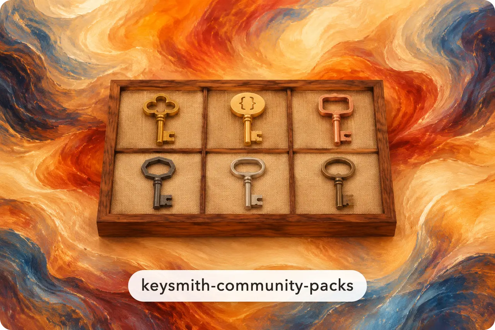
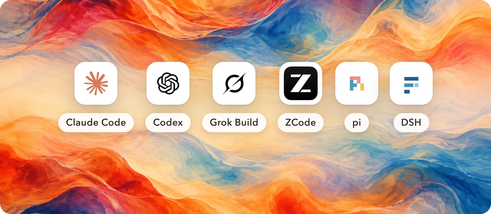
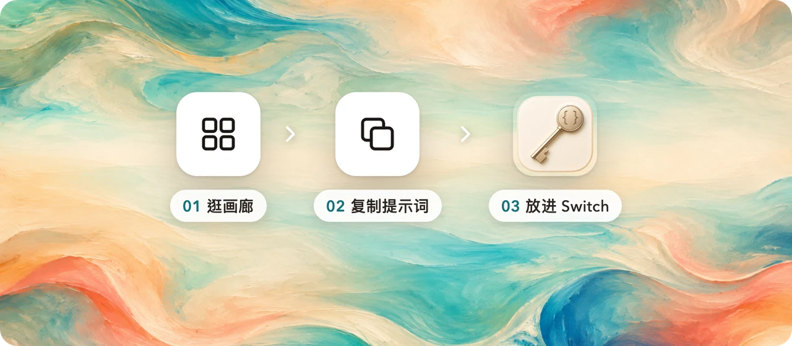
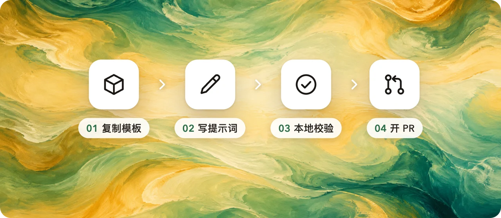
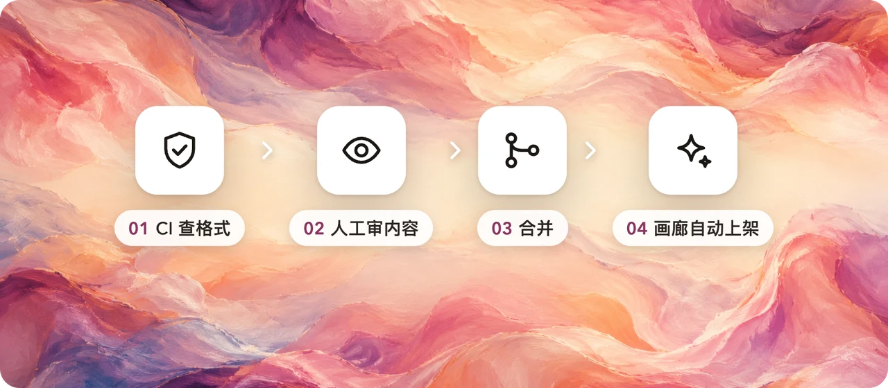

<!-- markdownlint-disable MD013 MD033 MD041 -->

<div align="center">



<h1>Keysmith 社区包</h1>

<p><b>大家做的提示词包，都放在这里。挑一个就能用，你做的也可以放进来。</b></p>

<p>
  <a href="https://keysmithswitch.com/packs/"></a>
  <a href="https://github.com/Jia-Ethan/keysmith-community-packs/actions/workflows/ci.yml"></a>
  <a href="https://github.com/Jia-Ethan/keysmith-community-packs/stargazers"></a>
  
  <a href="https://t.me/+xBqLYA65JPU1NjFk"></a>
</p>

<p>
  <a href="https://keysmithswitch.com/packs/"><b>逛画廊</b></a> ·
  <a href="CONTRIBUTING.md"><b>投稿</b></a> ·
  <a href="docs/SPEC-community.md">格式</a> ·
  <a href="README.en.md">English</a>
</p>

</div>

## 六个 Agent，都能用



社区包和 [Keysmith Switch](https://github.com/Jia-Ethan/keysmith-switch) 的官方拓展包用的是**同一套格式**。包里只放提示词和规则，**不含任何可执行代码**。

## 怎么用



到 **[画廊](https://keysmithswitch.com/packs/)** 挑一个包，复制里面的提示词，粘贴进 Keysmith Switch 的"我的提示词"就行。App 内一键安装是后续计划。

## 投稿一个包



```bash
# 01 照着示范包抄（包目录 + 边车）
cp -r packs/example.hello           packs/<handle>.<slug>
cp    packs/example.hello.meta.json packs/<handle>.<slug>.meta.json
# 02 写 prompts/*.md，改 pack.json 和边车
python3 scripts/check.py           # 03 全部 ok 再提交
# 04 开 PR
```

详细步骤见 **[CONTRIBUTING.md](CONTRIBUTING.md)**。包 id 写成 `<handle>.<slug>`；`keysmith.` 开头的 id 留给官方包。

## 每个包都经过人工审核



CI 只检查格式，内容由维护者逐个人工审核，过了才合并（[审核清单](docs/review-checklist.md)）。合并后，官网画廊会在下一次自动重建时上架这个包。

<details>
<summary><b>仓库里有什么</b></summary>

```
packs/<id>/            一个社区包（schema 1，只有内容）
packs/<id>.meta.json   边车：作者、画廊文案、分类
scripts/check.py       本地和 CI 用的校验
scripts/build_index.py 生成画廊读取的 community-index.json
scripts/packlib.py     官方校验器（原样复制过来，不要改）
docs/                  格式说明、审核清单
```

</details>

## Keysmith 系列

- [**Keysmith Switch**](https://github.com/Jia-Ethan/keysmith-switch)：桌面 App，一处管好所有 Agent 的提示词
- 各 Agent 的指令包：[codex-keysmith](https://github.com/Jia-Ethan/codex-keysmith) · [claude-keysmith](https://github.com/Jia-Ethan/claude-keysmith) · [grok-keysmith](https://github.com/Jia-Ethan/grok-keysmith) · [zcode-keysmith](https://github.com/Jia-Ethan/zcode-keysmith) · [pi-keysmith](https://github.com/Jia-Ethan/pi-keysmith) · [dsh-keysmith](https://github.com/Jia-Ethan/dsh-keysmith)

<div align="center">
<br />

**觉得有用，点个 ⭐ Star；有好用的提示词，欢迎投一个包。**

</div>
