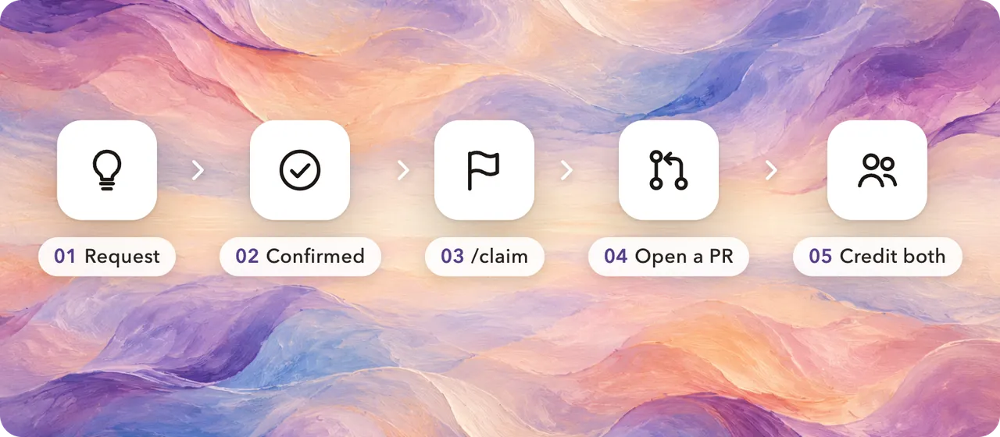

# Requests and claims

> 中文：[requests.md](requests.md)

You don't need to write code to take part. **You file a request, someone claims it and builds it**, and the gallery credits you both.



## 1. File a request

Use the [request form](https://github.com/Jia-Ethan/keysmith-community-packs/issues/new?template=request.yml). Be precise about three things:

- **The goal.** Say what you want to happen, not how to build it. For example: "Claude Code formats every file it edits."
- **Which agent.** Claude Code, Codex, Grok Build, ZCode, pi, DSH, or any of them.
- **How we'll know it works.** One or two checks anyone could run.

If the idea is still half-formed, talk it through in [Discussions → Ideas](https://github.com/Jia-Ethan/keysmith-community-packs/discussions/categories/ideas) first.

## 2. Confirmed

A maintainer reads each request and labels it:

| Label | Meaning |
| --- | --- |
| `needs-triage` | New and waiting for a maintainer |
| `needs-info` | Something is missing; please add it |
| `ready` | Clear and buildable, **waiting for someone to claim it** |
| `needs-backend` | Keysmith can't do this yet. It needs Keysmith itself to change first, and goes on the Keysmith Switch roadmap. |
| `tier-0` / `tier-1` / `tier-2` | Which tier the change belongs to (see below) |

## 3. Claim it

On a `ready` request, comment **`/claim`** on its own line. The bot assigns the request to you and labels it `claimed`.

- You can hold up to 3 claims at a time.
- Changed your mind? Comment `/unclaim` to hand it back. No hard feelings.
- After 14 quiet days you get a reminder, and any reply keeps the claim. If there's still no reply after 7 more days, the request goes back to the pool. An open PR counts as progress.

## 4. Open a PR

Build the pack following [CONTRIBUTING.en.md](../CONTRIBUTING.en.md). Put `Closes #<request number>` in the PR description, and add this to the pack's sidecar:

```json
"request": { "issue": 12, "by": "the requester's GitHub login" }
```

## 5. Credit both

Once the pack is merged, the gallery shows **Idea @requester · Built by @builder**.

## Three tiers of change

Keysmith is growing from prompts into a tool that can reshape the agent itself. Changes fall into three tiers by risk:

| Tier | Includes | Can it be a pack today? | Review |
| --- | --- | --- | --- |
| **0 Data** | Prompts, input rewrite rules | ✅ Yes | Maintainer reads the content |
| **1 Declarative** | Slash commands, subagents, text-only skills, config (no code runs) | ⏳ Format in design | Maintainer reviews content and reach |
| **2 Executable** | Hooks, MCP servers, plugins, statuslines, skills with scripts, permissions and env | ⏳ Format in design | **Line-by-line security review by the maintainer** |

You can already file and claim tier 1 and tier 2 requests, and discuss or prototype them. Once the installable format lands, they become real packs.
