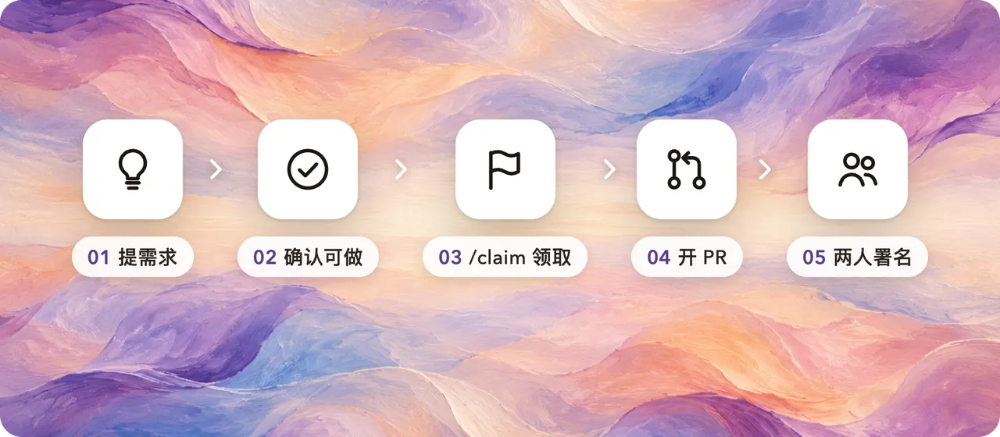

# 需求和领取

> English: [requests.en.md](requests.en.md)

不会写代码也能参与：**你提需求，有人领走来做**，做成后画廊里同时署上你们两个人。



## 1. 提需求

用 [需求表单](https://github.com/Jia-Ethan/keysmith-community-packs/issues/new?template=request.yml) 提，要写清楚三件事：

- **想实现什么**：说目的，不说做法。例："Claude Code 每次改完文件自动格式化"。
- **针对哪个 Agent**：Claude Code、Codex、Grok Build、ZCode、pi、DSH，或者都行。
- **怎样算做成**：一两条谁都能检查的标准。

想法还没成型的话，先去 [讨论区 Ideas](https://github.com/Jia-Ethan/keysmith-community-packs/discussions/categories/ideas) 聊。

## 2. 确认可做

维护者看过以后打标签：

| 标签 | 意思 |
| --- | --- |
| `needs-triage` | 刚提交，等维护者看 |
| `needs-info` | 还缺信息，请补充 |
| `ready` | 需求清楚、可以做，**等人来领** |
| `needs-backend` | Keysmith 现在还做不到，要先改 Keysmith 本身（会进 Keysmith Switch 的路线图） |
| `tier-0` / `tier-1` / `tier-2` | 改动属于哪一层，见下 |

## 3. 领取

在 `ready` 的需求下评论一行 **`/claim`**，机器人会把它指派给你并标上 `claimed`。

- 一个人同时最多领 3 个。
- 不想做了，评论 `/unclaim` 放回去，完全没关系。
- 14 天没动静会提醒一次，回复一句就算还在做；再过 7 天没回应会放回需求池。开了 PR 就算有进展。

## 4. 开 PR

照 [CONTRIBUTING.md](../CONTRIBUTING.md) 做包。PR 描述里写 `Closes #<需求编号>`，在包的边车里加上：

```json
"request": { "issue": 12, "by": "提需求的人的 GitHub 用户名" }
```

## 5. 两人署名

合并后，画廊上这个包会写 **点子 @提需求的人 · 实现 @做的人**。

## 三层改动

Keysmith 要做的不只是提示词，还要能改造 Agent 本身。改动按风险分三层：

| 层 | 包括 | 现在能不能做成包 | 审核 |
| --- | --- | --- | --- |
| **0 数据** | 提示词、输入替换规则 | ✅ 能 | 维护者看内容 |
| **1 声明式** | 斜杠命令、子 Agent、纯文本技能、配置项（不运行代码） | ⏳ 格式设计中 | 维护者看内容和影响范围 |
| **2 可执行** | hook、MCP server、插件、状态栏、带脚本的技能、权限和环境变量 | ⏳ 格式设计中 | **维护者逐行安全审核** |

第 1、2 层的需求现在就可以提、可以领，可以先讨论和做原型。能装进 App 的格式做好后，这些需求就能变成真正的包。
